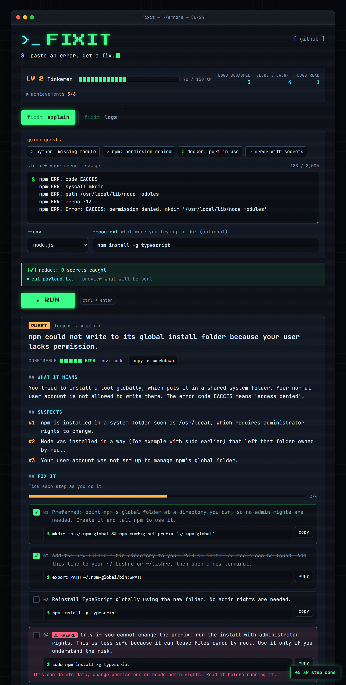

# Fixit

**Paste an error. Get a fix.**

Fixit turns terminal errors and log files into plain-language explanations and step-by-step fixes. No account, no install, no API key.

**Live:** https://fixit-errors.netlify.app



**Full breakdown:** [docs/OVERVIEW.md](docs/OVERVIEW.md) covers how it works, which files to look at, who it's for and why. **Demo kit:** [demo/](demo/README.md) has a real-world example for every use case.

Built for the hackathon theme **Simplify the Everyday**: everyone who uses a computer hits error messages written for machines. Fixit translates them for humans.

## What it does

**Explain Error.** Paste an error, a stack trace or command output (up to 8,000 characters). You get:

- a one-line summary and what it means in plain English
- the likely causes, most likely first
- step-by-step fixes with copyable commands
- a **⚠ Caution** badge on any command that deletes data, changes permissions or uses `sudo`
- how to check it worked, and a confidence level

**Log Digest.** Paste a log or drop a `.log` or `.txt` file (up to 1 MB). You get a health verdict, the top issues grouped with counts and first-seen times, the probable root cause and next steps. **Explain this** on any issue sends it to Explain Error.

Both modes have one-click samples, so you can try it in seconds.

**It's a game, a little.** The page looks like a terminal, and fixing things earns XP. Every fix is a quest: tick the steps off as you go to fill the progress bar and "squash the bug". Log issues show up as enemies with HP bars sized by how often they occur. You level up from Newbie to Kernel Sage and unlock six achievements along the way. Progress is saved only in your browser and is never sent anywhere.

## Privacy

Secrets are removed **in your browser, before anything is sent**, and the page shows how many were removed and a preview of exactly what will be sent. The server runs the same rules again as a safety net.

Removed: emails, IP addresses, auth headers, JWTs, API keys (`sk-…`, `ghp_…`, `AKIA…`, `xox…`), `password=`-style secrets, credentials in connection strings, private keys, user names in home-directory paths and long random tokens.

Nothing is stored. The function logs only the mode, input length, response time and status code. Your (redacted) text is sent to an AI provider to generate the answer.

## How it works

```
Browser                               Netlify                               AI provider
───────                               ───────                               ───────────
paste or drop  ──►  redact secrets     POST /api/analyse                     Claude Haiku 5.5
                    collapse repeats   ──►  validate + size limits
                    trim to 40k chars       rate limit (10/min/visitor)
                    preview + counter       redact again              ──►    reply as JSON
                                            check JSON + completeness  ◄──
render result  ◄──────────────────────────  return JSON
(text only, never HTML)
```

- **Front end:** plain HTML, CSS and TypeScript, bundled by Vite. No framework. Fonts (JetBrains Mono, Press Start 2P) are bundled, so the page loads nothing from other sites. [`src/game.ts`](src/game.ts) holds the XP and achievements.
- **Backend:** one Netlify Function, [`netlify/functions/analyse/analyse.mts`](netlify/functions/analyse/analyse.mts). It validates the request with Zod, redacts again, calls the model with a 25 second timeout, and checks the reply against the schema and for empty fields, retrying once if needed.
- **Model:** Claude Haiku 5.5 via Netlify's AI Gateway, which supplies the key on Netlify. [`llm.ts`](netlify/functions/analyse/llm.ts) is the only provider-specific file.
- **Shared code:** [`shared/redact.ts`](shared/redact.ts) (one set of rules for browser and server) and [`shared/schema.ts`](shared/schema.ts) (request and response schemas).
- **Log trimming:** [`src/trimLog.ts`](src/trimLog.ts) folds repeated lines into one with an exact count, then keeps errors, the lines around them, and the start and end of the log.

## Run it locally

Requires Node 20 or later.

```bash
npm install
cp .env.example .env      # add your ANTHROPIC_API_KEY
npx netlify dev           # page and function on http://localhost:8888
```

On Netlify, leave `ANTHROPIC_API_KEY` unset to use the AI Gateway, or set it as a secret to use your own key.

| Variable | Default | Purpose |
| --- | --- | --- |
| `ANTHROPIC_API_KEY` | (gateway) | Model access; never sent to the browser |
| `LLM_MODEL` | `claude-haiku-5-5` | Swap models without a code change |
| `MAX_INPUT_CHARS` | `40000` | Server-side size cap |
| `LLM_STRUCTURED_OUTPUT` | off | Set to `on` to send the schema as a structured-output format |

## Tests

```bash
npm test                                             # 81 unit tests: redaction, trimming, the function
node scripts/smoke.mts https://fixit-errors.netlify.app          # live fixtures E1-E6 and D1-D3, with timings
node scripts/smoke.mts https://fixit-errors.netlify.app --s3     # rate-limit test
```

The fixtures in [`tests/fixtures/`](tests/fixtures/) double as the page's demo samples.

## Limits

- Suggestions may be wrong. Read any command before running it, especially flagged ones.
- Explain Error takes up to 8,000 characters; Log Digest sends at most 40,000 after trimming.
- 10 analyses per minute per visitor.

Built with AI coding agents.
